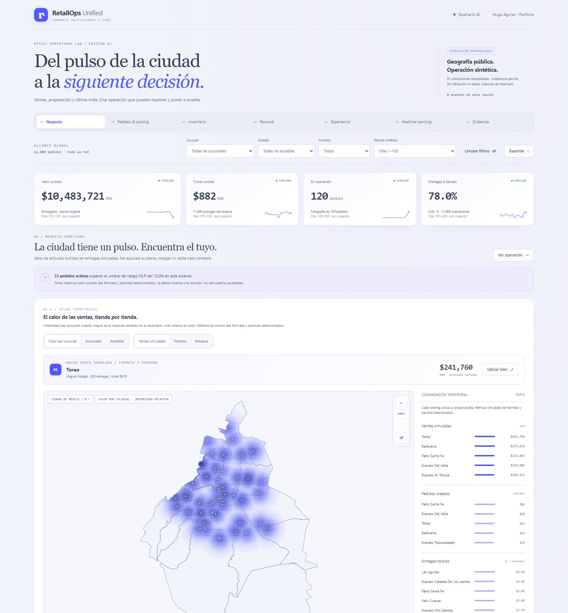

# RetailOps Unified

Prototipo de **inteligencia operativa para retail**: conecta ventas por sucursal,
disponibilidad, preparación de pedidos, capacidad de personal, experiencia del
cliente y un modelo de clasificación en una sola aplicación autocontenida.

[](https://github.com/Dev-HugoAguilar/retailops-unified/actions/workflows/tests.yml)
[](#demo)
[](#demo)

> **Alcance.** Operación **simulada**. No es información interna de ninguna
> cadena comercial: las ventas, pedidos, inventarios y personal provienen de un
> generador sintético determinista. La calidad predictiva refleja ese generador y
> no demuestra generalización ni superioridad estadística.

---

## Demo

El repositorio contiene un único archivo de aplicación, sin dependencias, sin
compilación y sin llamadas de red:

```bash
git clone https://github.com/Dev-HugoAguilar/retailops-unified.git
cd retailops-unified
python -m http.server 8000 --directory app
```

Abre <http://127.0.0.1:8000/>. También funciona abriendo `app/index.html`
directamente en el navegador.



## Qué demuestra

- **Siete vistas conectadas** que comparten filtros y contexto: negocio, pedidos
  y *picking*, inventario, personal, experiencia, machine learning y evidencias.
- **Un modelo interpretable de extremo a extremo**: se declara el objetivo, las
  cinco entradas, el preprocesamiento y la validación por bloques temporales; la
  inferencia de la red se ejecuta en el navegador con los pesos embebidos.
- **Un mapa que no miente sobre su suavizado**: el calor usa un núcleo gaussiano
  de σ ≈ 2 km y composición por máximo local, de modo que las sucursales cercanas
  no se suman artificialmente.
- **Trazabilidad del pedido**: el recorrido completo de una orden —por asignar,
  en preparación, listo, en reparto y entregado— con sus eventos y su desenlace.
- **Honestidad de datos**: el directorio de tiendas es parcial (51 ubicaciones,
  13 de las 16 alcaldías) y se cita su origen secundario.

## Cómo está construido

### Datos

51 ubicaciones de Walmart Supercenter y Express recopiladas de un directorio
secundario, con cotejo oficial limitado. Las geometrías de referencia de alcaldías
provienen de un repositorio público citado en
[`docs/ALCANCE.md`](docs/ALCANCE.md). Sobre ese catálogo, un generador
determinista produce ventas, surtido, pedidos, tiempos de preparación, plantilla y
calificaciones.

### Modelo

- **Objetivo**: clasificar si la duración total simulada del pedido supera la
  promesa de entrega.
- **Entradas**: número de referencias distintas, piezas totales, líneas de
  *picking*, minutos de preparación y holgura de la ventana.
- **Preprocesamiento**: `StandardScaler` ajustado sobre el conjunto de
  entrenamiento.
- **Modelo**: `MLPClassifier` comparado con `LogisticRegression` como referencia.
- **Validación**: bloques temporales sintéticos, para no evaluar con datos
  posteriores al periodo de ajuste.
- **Inferencia**: los pesos quedan embebidos en la página; el navegador evalúa la
  red sin llamar a ningún servicio.

### Interfaz

Un solo documento HTML con CSS y SVG propios. La vista inicial es **calor por
sucursal**; desde ahí se puede recorrer una tienda hasta un pedido, su
preparación, la asignación, la entrega y su evidencia. El zoom llega a 300 %, los
filtros se conservan entre gestos y el foco es visible en toda la navegación.

## Estructura

```text
app/index.html       Aplicación completa: datos, estilos, mapa y modelo
docs/FICHA.md        Ficha editorial del proyecto (contexto, método, límites)
docs/ALCANCE.md      Procedencia de datos, atribuciones y alcance
docs/ACEPTACION.md   Criterios de aceptación con los que se verificó la demo
docs/cover.jpg       Captura real de la aplicación servida
```

El archivo `app/index.html` pesa **13,416,449 bytes**
(SHA-256 `CDC6D7C930ECEA96F9A61CCFBCDC18FA3BC96B9968E084D5B24A4DBE01D00AB5`). Se
versiona como archivo regular: está muy por debajo del límite de 100 MB de GitHub
y se decidió **no** usar Git LFS para no imponer un cliente adicional a quien
quiera abrir un prototipo estático.

## Interacción

| Acción | Resultado |
|---|---|
| Vista inicial | Calor por sucursal, con métrica de importe |
| `+` / `−` | Zoom de 100 % a 300 %; el mínimo vuelve a 100 % |
| Restablecer | Devuelve el encuadre (`viewBox 0 0 820 940`) |
| Arrastrar | Mueve el mapa sin seleccionar una tienda |
| Cambiar capa o métrica | Recalcula el calor conservando los filtros |
| Abrir un pedido | Recorre los cinco estados y muestra la evidencia |

## Verificación

La demo se verificó en un navegador real con instrumentación automatizada:

- **51 comprobaciones** de estructura, contenido, semántica y *layout* en
  1440 / 1024 / 390 px sin desbordamiento global.
- **8 comprobaciones** del recorrido de entrega: estados, tiempos, calificación y
  reinicio.
- Líder verificado en Toreo con **$241,760 MXN**; el valor no cambia al hacer zoom
  ni al arrastrar.
- Recorrido de pedido con **85 minutos**, calificación **4/5** y **4 eventos**.

Los criterios completos están en [`docs/ACEPTACION.md`](docs/ACEPTACION.md).

## Límites

- Operación simulada: ventas = valor de artículos surtidos, no cobros, ingresos,
  margen ni demanda.
- 51 ubicaciones, lista parcial; 13 de las 16 alcaldías tienen al menos una tienda.
- Las métricas del modelo describen el generador sintético, no el desempeño real.
- No se probaron Safari ni Firefox, ni dispositivos físicos, ni se midieron FPS.
- El mapa es una referencia territorial: no representa rutas, tráfico ni entregas
  reales.

## Datos y atribución

Directorio de tiendas: [BizLocationDB](https://bizlocationdb.com/locations/walmart/mexico/r/mexico-city)
(fuente secundaria). Geometrías de alcaldías:
[`npalomin/shi_dataset_cdmx`](https://github.com/npalomin/shi_dataset_cdmx).
Detalle de licencias y límites en [`docs/ALCANCE.md`](docs/ALCANCE.md). Este
repositorio no incluye un archivo `LICENSE` propio: se respetan las condiciones de
las fuentes citadas.

## Contribuir y seguridad

Convenciones en [`CONTRIBUTING.md`](CONTRIBUTING.md). Para reportar un problema de
seguridad, usa los avisos privados de [`SECURITY.md`](SECURITY.md).
